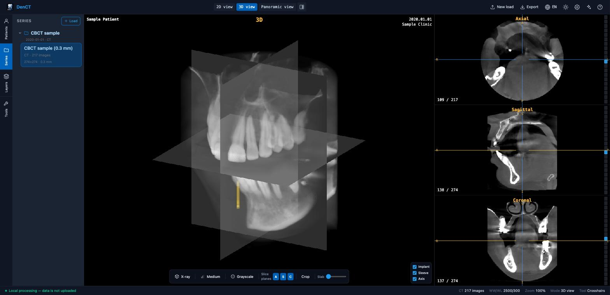

# 🦷 DenCT — Polski

🇨🇿 [Čeština](README-cs.md) · 🇩🇰 [Dansk](README-da.md) · 🇩🇪 [Deutsch](README-de.md) · 🇬🇧 [English](README-en.md) · 🇪🇸 [Español](README-es.md) · 🇫🇷 [Français](README-fr.md) · 🇭🇺 [Magyar](README-hu.md) · 🇳🇴 [Norsk](README-nb.md) · 🇵🇱 Polski · 🇵🇹 [Português](README-pt.md) · 🇸🇰 [Slovenčina](README-sk.md) · 🇫🇮 [Suomi](README-fi.md) · 🇸🇪 [Svenska](README-sv.md) · 🇷🇺 [Русский](README-ru.md) · 🇺🇦 [Українська](README-uk.md) · [⬅ Wstecz](../README.md)

Osadzalna **stomatologiczna przeglądarka DICOM CBCT / CT** dla React + TypeScript: MPR i prawdziwe 3D, rekonstrukcja panoramiczna (OPG), przekroje poprzeczne, nawigowane planowanie implantów, marginesy bezpieczeństwa, jakość kości, szablon chirurgiczny do druku (STL) oraz wielojęzyczny raport PDF.

▶ **[Wypróbuj demo online](https://dental-cbct-viewer.vercel.app)** — wczytuje zanonimizowane przykładowe CBCT i działa w całości w Twojej przeglądarce.

**Widok panoramiczny — OPG, przekrój poprzeczny i 3D z zaplanowanym implantem**
[](https://dental-cbct-viewer.vercel.app)

**Widok 3D — rendering wolumetryczny z powiązanymi widokami osiowym / strzałkowym / czołowym**
[](https://dental-cbct-viewer.vercel.app)

---

## Instalacja

```bash
npm install dental-cbct-viewer react react-dom
```

- **React 18 lub 19** (peer dependency).
- Tylko ESM; wymaga bundlera z obsługą Web Worker + WASM (Vite, webpack 5, Next.js, Rollup).
- Cornerstone3D, vtk.js, jsPDF i dicom-parser są instalowane jako zależności.

### ⚠️ Izolacja cross-origin (wymagana)

Workery dekodujące DICOM używają `SharedArrayBuffer`. Serwuj stronę hosta z nagłówkami:

```
Cross-Origin-Opener-Policy: same-origin
Cross-Origin-Embedder-Policy: require-corp
```

Bez tych nagłówków dekodowanie obrazów nie zadziała. W Next.js ustaw je przez `headers()` w `next.config.js`; w Vite przez `server.headers`.

## Szybki start

```tsx
import { DicomViewer } from "dental-cbct-viewer";
import "dental-cbct-viewer/style.css";

export function Planner() {
  return (
    <div style={{ height: "100vh" }}>
      <DicomViewer lang="en" />
    </div>
  );
}
```

Przeglądarka wypełnia element nadrzędny — nadaj mu określone wymiary. Dostarcza własny arkusz stylów; tryb ciemny jest domyślny i ograniczony do elementu głównego przeglądarki (`.dcv-root`), więc nigdy nie zmienia motywu strony hosta.

## Props

| Prop | Typ | Opis |
| --- | --- | --- |
| `patientId` | `string` | Identyfikator pacjenta wyświetlany w nagłówku raportu. |
| `patientName` | `string` | Imię i nazwisko pacjenta wyświetlane w nagłówku raportu. |
| `initialPlan` | `PlanData` | Wczytuje zapisany plan przy montowaniu. |
| `initialLayout` | `'1x1' \| '1+3' \| '2x2' \| 'OPG2+1' \| 'IO3D'` | Układ początkowy. |
| `lang` | `'cs' \| 'da' \| 'de' \| 'en' \| 'es' \| 'fi' \| 'fr' \| 'hu' \| 'nb' \| 'pl' \| 'pt' \| 'ru' \| 'sk' \| 'sv' \| 'uk'` | Język interfejsu. Bez niego przeglądarka używa ostatniego wyboru użytkownika, następnie języka przeglądarki / systemu, a na końcu angielskiego. |
| `onPlanChange` | `(plan: PlanData) => void` | Wywoływane (z opóźnieniem debounce) przy każdej zmianie planu. |
| `onImplantsChange` | `(implants: ImplantData[]) => void` | Wywoływane przy każdej zmianie listy implantów. |
| `className` | `string` | Dodatkowa klasa elementu głównego. |
| `embedded` | `boolean` | Ukrywa wbudowany baner z zastrzeżeniem (zgodą zarządza host). |
| `autosave` | `boolean` | Przechowuje kopię planu dla każdego badania w sessionStorage, aby przeładowanie ją przywróciło (domyślnie `true`). Wyłącz, gdy host sam zapisuje plany przez `onPlanChange`. |
| `features` | `ViewerFeatures` | Przełączniki edycji: `{ implantPlanning?: boolean; drillGuide?: boolean }`, oba domyślnie włączone. `implantPlanning: false` daje czystą przeglądarkę obrazów. Zob. [API.md](../API.md#editions). |
| `branding` | `boolean` | Pokazuje promocję w sieci (gwiazdka GitHub, okno O programie, linki do innych projektów). Domyślnie `true`. |
| `theme` | `'dark' \| 'light'` | Ciemny / jasny motyw sterowany przez hosta; zastępuje zapamiętany wybór i ukrywa własne przełączniki przeglądarki. |

## API imperatywne (ref)

```tsx
import { useRef } from "react";
import { DicomViewer, type DicomViewerHandle } from "dental-cbct-viewer";

const ref = useRef<DicomViewerHandle>(null);
// <DicomViewer ref={ref} />
```

| Metoda | Sygnatura | Opis |
| --- | --- | --- |
| `getImplants` | `() => ImplantData[]` | Bieżące implanty. |
| `addImplant` | `(implant: ImplantData) => void` | Dodaje implant. |
| `updateImplant` | `(implant: ImplantData) => void` | Zastępuje implant o danym id. |
| `removeImplant` | `(id: string) => void` | Usuwa implant. |
| `getPlan` | `() => PlanData` | Serializuje bieżący plan. |
| `loadPlan` | `(plan: PlanData) => void` | Wczytuje plan. |
| `loadStudy` | `(files: File[]) => Promise<void>` | Wczytuje DICOM z plików. |
| `loadScans` | `(files: File[]) => Promise<void>` | Importuje skany powierzchniowe (STL / OBJ / PLY) do otwartego badania; łuk jest rozpoznawany po nazwie pliku. |
| `loadSample` | `(kind?: 'ct' \| 'ctIo') => Promise<void>` | Wczytuje dołączony zanonimizowany przykład — `'ct'` samo CBCT, `'ctIo'` CBCT wraz z dopasowanymi skanami wewnątrzustnymi (host musi serwować `/sample/*` i `/sample-io/*` — patrz niżej). |
| `setLayout` | `(mode: LayoutMode) => void` | Zmienia układ. |
| `setActiveView` | `(view: ViewKey) => void` | Zmienia widok 1×1. |
| `exportPdf` | `() => Promise<void>` | Tworzy i pobiera raport PDF. |
| `exportGuideStl` | `() => Promise<boolean>` | Tworzy i pobiera szablon chirurgiczny STL (false, jeśli nie ma implantu nawigowanego). |
| `openSettings` | `() => void` | Otwiera okno ustawień. |
| `openHelp` | `() => void` | Otwiera panel pomocy. |
| `startTour` | `() => void` | Uruchamia przewodnik wprowadzający. |

## Rdzeń bez frameworka (`/core`)

Czysty, bez React — działa w Node, testach lub Twojej własnej logice:

```ts
import {
  // Implant data model + system catalog
  IMPLANT_SYSTEMS, getImplantSystem,
  // Geometry
  implantWorldAxis, archFrameAt, nearestArchFrame,
  // Safety (nerve / sinus / neighbour clearances)
  evaluateImplant,
  // Bone quality (Misch D1–D5, HU at the implant site)
  classifyBone, sampleImplantBoneHU,
  // Curved-planar-reformation sampling + arch curve math
  // Drill-guide geometry + binary STL export
  triMeshToBinarySTL,
} from "dental-cbct-viewer/core";
```

Jądro operacji logicznych CSG (`manifold-3d`, ok. 1,5 MB WASM) jest wczytywane leniwie w generatorze szablonu, więc import `/core` dla geometrii/bezpieczeństwa pozostaje lekki.

## Model danych (najważniejsze)

- **`ImplantData`** — punkt wejścia w przestrzeni świata + oś wierzchołka (z dwóch kątów względem najbliższej ramki łuku), średnica, długość, `systemId` oraz opcjonalny plan `guided` (odsunięcie/wysokość tulejki, długość wiertła).
- **`IMPLANT_SYSTEMS`** — katalog (Generic, Alpha-Bio, Straumann BLX, NobelActive) ze średnicami tulejek dla poszczególnych systemów.
- **`PlanData`** — trwała część stanu (implanty, znaczniki anatomiczne, krzywa łuku, przekrój poprzeczny, progi bezpieczeństwa, pola raportu, ustawienia wyświetlania i szablonu oraz rejestracje zaimportowanych skanów — tylko deskryptory, siatki pozostają w pamięci). Zapisuj go z `onPlanChange` / `getPlan`, przywracaj przez `initialPlan` / `loadPlan`.

## Dołączony przykład

`loadSample()` i przycisk na stronie startowej pobierają ok. 16 MB zanonimizowanego CBCT z `/sample/meta.json` + `/sample/volume.raw.bin`. Te zasoby **nie** są zawarte w pakiecie npm (aby był mały). Aby użyć przykładu we własnej aplikacji, skopiuj `public/sample/` z repozytorium do katalogu publicznego aplikacji. W normalnym użyciu wczytujesz własny DICOM przez `loadStudy(files)`. `loadSample('ctIo')` i drugi przycisk na stronie startowej używają zamiast tego `/sample-io/` (ok. 19 MB: wolumen, `scans.json` i dwie spakowane gzipem siatki łuków) — jeśli go potrzebujesz, skopiuj także `public/sample-io/`.

## Bundlery hosta

- **Vite:** działa od razu.
- **Next.js / webpack 5:** renderuj w komponencie klienckim (`"use client"`); przeglądarka odczytuje DOM przy montowaniu. Ustaw nagłówki COOP/COEP. Zasoby Worker + WASM są wstępnie zbundlowane.

## Cytowanie

Jeśli DenCT przyczynia się do publikowanej przez Ciebie pracy, prosimy o jego zacytowanie: repozytorium zawiera plik
[`CITATION.cff`](../CITATION.cff) (przycisk GitHub **Cite this repository** generuje
BibTeX lub APA), a każde wydanie jest archiwizowane w Zenodo.

Cytuj koncepcyjny DOI [`10.5281/zenodo.23458076`](https://doi.org/10.5281/zenodo.23458076)
dla oprogramowania ogólnie — zawsze wskazuje on najnowsze zarchiwizowane wydanie — lub
DOI konkretnego wydania, aby wskazać dokładną wersję ([`10.5281/zenodo.24484034`](https://doi.org/10.5281/zenodo.24484034)
dla v1.5.0).

## Licencja i zastrzeżenie

MIT © Zoltán Dul; dołączona czcionka Roboto na licencji Apache-2.0.

**Zastrzeżenie medyczne:** oprogramowanie wyłącznie do celów badawczych/demonstracyjnych — nie jest certyfikowanym wyrobem medycznym i nie służy do diagnostyki klinicznej, planowania leczenia, precyzyjnych pomiarów ani procedur implantologicznych.
