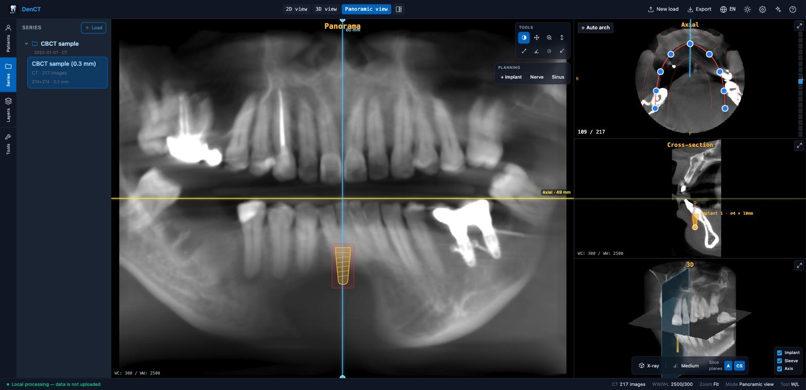

# 🦷 DenCT — Slovenčina

🇨🇿 [Čeština](README-cs.md) · 🇩🇰 [Dansk](README-da.md) · 🇩🇪 [Deutsch](README-de.md) · 🇬🇧 [English](README-en.md) · 🇪🇸 [Español](README-es.md) · 🇫🇷 [Français](README-fr.md) · 🇭🇺 [Magyar](README-hu.md) · 🇳🇴 [Norsk](README-nb.md) · 🇵🇱 [Polski](README-pl.md) · 🇵🇹 [Português](README-pt.md) · 🇸🇰 Slovenčina · 🇫🇮 [Suomi](README-fi.md) · 🇸🇪 [Svenska](README-sv.md) · 🇷🇺 [Русский](README-ru.md) · 🇺🇦 [Українська](README-uk.md) · [⬅ Späť](../README.md)

Vložiteľný **stomatologický prehliadač CBCT / CT DICOM** pre React + TypeScript: MPR + skutočné 3D, panoramatická (OPG) rekonštrukcia, priečne rezy, navigované plánovanie implantátov, bezpečnostné odstupy, kvalita kosti, tlačiteľná vŕtacia šablóna (STL) a viacjazyčná PDF správa.

▶ **[Vyskúšajte živé demo](https://dental-cbct-viewer.vercel.app)** — načíta anonymizované ukážkové CBCT a beží úplne vo vašom prehliadači.

**Panoramatické zobrazenie — OPG, priečny rez a 3D s naplánovaným implantátom**
[](https://dental-cbct-viewer.vercel.app)

**3D zobrazenie — objemové vykresľovanie s prepojeným axiálnym / sagitálnym / koronálnym rezom**
[](https://dental-cbct-viewer.vercel.app)

---

## Inštalácia

```bash
npm install dental-cbct-viewer react react-dom
```

- **React 18 alebo 19** (peer dependency).
- Iba ESM; vyžaduje bundler s podporou Web Workerov + WASM (Vite, webpack 5, Next.js, Rollup).
- Cornerstone3D, vtk.js, jsPDF a dicom-parser sa inštalujú ako závislosti.

### ⚠️ Cross-origin izolácia (povinná)

Dekódovacie workery DICOM používajú `SharedArrayBuffer`. Hostiteľskú stránku poskytujte s hlavičkami:

```
Cross-Origin-Opener-Policy: same-origin
Cross-Origin-Embedder-Policy: require-corp
```

Bez týchto hlavičiek dekódovanie obrazu nepobeží. V Next.js ich nastavte cez `headers()` v `next.config.js`; vo Vite cez `server.headers`.

## Rýchly štart

```tsx
import { DicomViewer } from "dental-cbct-viewer";
import "dental-cbct-viewer/style.css";

export function Planner() {
  return (
    <div style={{ height: "100vh" }}>
      <DicomViewer lang="en" />
    </div>
  );
}
```

Prehliadač vyplní svojho rodiča — dajte mu kontajner s danou veľkosťou. Dodáva sa s vlastným štýlom; tmavý režim je predvolený a je obmedzený na koreň prehliadača (`.dcv-root`), takže nikdy nemení motív hostiteľskej stránky.

## Props

| Prop | Typ | Popis |
| --- | --- | --- |
| `patientId` | `string` | ID pacienta zobrazené v hlavičke správy. |
| `patientName` | `string` | Meno pacienta zobrazené v hlavičke správy. |
| `initialPlan` | `PlanData` | Načíta uložený plán pri pripojení. |
| `initialLayout` | `'1x1' \| '1+3' \| '2x2' \| 'OPG2+1' \| 'IO3D'` | Počiatočné rozloženie. |
| `lang` | `'cs' \| 'da' \| 'de' \| 'en' \| 'es' \| 'fi' \| 'fr' \| 'hu' \| 'nb' \| 'pl' \| 'pt' \| 'ru' \| 'sk' \| 'sv' \| 'uk'` | Jazyk rozhrania. Bez neho prehliadač použije poslednú voľbu používateľa, potom jazyk prehliadača / OS, potom angličtinu. |
| `onPlanChange` | `(plan: PlanData) => void` | Volá sa (s debounce) pri každej zmene plánu. |
| `onImplantsChange` | `(implants: ImplantData[]) => void` | Volá sa pri každej zmene zoznamu implantátov. |
| `className` | `string` | Ďalšia trieda na koreňovom prvku. |
| `embedded` | `boolean` | Potlačí vstavaný banner s upozornením (súhlas spravuje hostiteľ). |
| `autosave` | `boolean` | Uchováva kópiu plánu pre každú štúdiu v sessionStorage, aby ju opätovné načítanie obnovilo (predvolené `true`). Vypnite, ak hostiteľ ukladá plány sám cez `onPlanChange`. |
| `features` | `ViewerFeatures` | Prepínače edície: `{ implantPlanning?: boolean; drillGuide?: boolean }`, obe predvolene zapnuté. `implantPlanning: false` dáva čistý zobrazovací prehliadač. Pozri [API.md](../API.md#editions). |
| `branding` | `boolean` | Zobrazí webovú propagáciu (hviezdička GitHub, okno O aplikácii, odkazy na ďalšie projekty). Predvolené `true`. |
| `theme` | `'dark' \| 'light'` | Tmavý / svetlý motív riadený hostiteľom; prepíše zapamätanú voľbu a skryje vlastné prepínače prehliadača. |

## Imperatívne API (ref)

```tsx
import { useRef } from "react";
import { DicomViewer, type DicomViewerHandle } from "dental-cbct-viewer";

const ref = useRef<DicomViewerHandle>(null);
// <DicomViewer ref={ref} />
```

| Metóda | Signatúra | Popis |
| --- | --- | --- |
| `getImplants` | `() => ImplantData[]` | Aktuálne implantáty. |
| `addImplant` | `(implant: ImplantData) => void` | Pridá implantát. |
| `updateImplant` | `(implant: ImplantData) => void` | Nahradí implantát podľa id. |
| `removeImplant` | `(id: string) => void` | Odstráni implantát. |
| `getPlan` | `() => PlanData` | Serializuje aktuálny plán. |
| `loadPlan` | `(plan: PlanData) => void` | Načíta plán. |
| `loadStudy` | `(files: File[]) => Promise<void>` | Načíta DICOM zo súborov. |
| `loadScans` | `(files: File[]) => Promise<void>` | Importuje povrchové skeny (STL / OBJ / PLY) k otvorenej štúdii; oblúk sa odhadne z názvu súboru. |
| `loadSample` | `(kind?: 'ct' \| 'ctIo') => Promise<void>` | Načíta pribalenú anonymizovanú ukážku — `'ct'` samotné CBCT, `'ctIo'` CBCT spolu s párovými intraorálnymi skenmi (hostiteľ musí poskytovať `/sample/*` a `/sample-io/*` — pozri nižšie). |
| `setLayout` | `(mode: LayoutMode) => void` | Prepne rozloženie. |
| `setActiveView` | `(view: ViewKey) => void` | Prepne zobrazenie 1×1. |
| `exportPdf` | `() => Promise<void>` | Vytvorí a stiahne PDF správu. |
| `exportGuideStl` | `() => Promise<boolean>` | Vytvorí a stiahne STL vŕtacej šablóny (false, ak chýba navigovaný implantát). |
| `openSettings` | `() => void` | Otvorí dialóg nastavení. |
| `openHelp` | `() => void` | Otvorí panel pomocníka. |
| `startTour` | `() => void` | Spustí úvodnú prehliadku. |

## Jadro bez frameworku (`/core`)

Čisté, bez Reactu — beží v Node, v testoch alebo vo vašej vlastnej logike:

```ts
import {
  // Implant data model + system catalog
  IMPLANT_SYSTEMS, getImplantSystem,
  // Geometry
  implantWorldAxis, archFrameAt, nearestArchFrame,
  // Safety (nerve / sinus / neighbour clearances)
  evaluateImplant,
  // Bone quality (Misch D1–D5, HU at the implant site)
  classifyBone, sampleImplantBoneHU,
  // Curved-planar-reformation sampling + arch curve math
  // Drill-guide geometry + binary STL export
  triMeshToBinarySTL,
} from "dental-cbct-viewer/core";
```

Jadro CSG booleovských operácií (`manifold-3d`, ~1,5 MB WASM) sa načítava lenivo vnútri generátora šablóny, takže import `/core` pre geometriu/bezpečnosť zostáva ľahký.

## Dátový model (základy)

- **`ImplantData`** — vstupný bod vo svetových súradniciach + os k apexu (z dvoch uhlov voči najbližšiemu rámcu oblúka), priemer, dĺžka, `systemId` a voliteľný plán `guided` (odsadenie/výška puzdra, dĺžka vrtáka).
- **`IMPLANT_SYSTEMS`** — katalóg (Generic, Alpha-Bio, Straumann BLX, NobelActive) s priemermi puzdier pre jednotlivé systémy.
- **`PlanData`** — uložiteľná časť stavu (implantáty, anatomické značky, krivka oblúka, priečny rez, bezpečnostné prahy, polia správy, nastavenia zobrazenia a šablóny a registrácie importovaných skenov — iba popisy, siete zostávajú v pamäti). Ukladajte ho z `onPlanChange` / `getPlan`, obnovujte cez `initialPlan` / `loadPlan`.

## Pribalená ukážka

`loadSample()` a tlačidlo na úvodnej stránke sťahujú ~16 MB anonymizované CBCT z `/sample/meta.json` + `/sample/volume.raw.bin`. Tieto súbory **nie sú** súčasťou balíka npm (aby zostal malý). Ak chcete ukážku použiť vo svojej aplikácii, skopírujte `public/sample/` z repozitára do verejného adresára svojej aplikácie. Pri bežnom používaní načítavate vlastný DICOM cez `loadStudy(files)`. `loadSample('ctIo')` a druhé tlačidlo na úvodnej stránke používajú namiesto toho `/sample-io/` (~19 MB: objem, `scans.json` a dve siete oblúkov komprimované gzipom) — ak ich chcete, skopírujte aj `public/sample-io/`.

## Hostiteľské bundlery

- **Vite:** funguje bez úprav.
- **Next.js / webpack 5:** vykresľujte vnútri klientskeho komponentu (`"use client"`); prehliadač pri pripojení číta DOM. Nastavte hlavičky COOP/COEP. Súbory workerov + WASM sú vopred pribalené.

## Citácia

Ak DenCT prispieva k práci, ktorú publikujete, citujte ho, prosím: repozitár obsahuje
[`CITATION.cff`](../CITATION.cff) (tlačidlo GitHubu **Cite this repository** vygeneruje
BibTeX alebo APA) a každé vydanie je archivované na Zenodo.

Citujte koncepčné DOI [`10.5281/zenodo.23458076`](https://doi.org/10.5281/zenodo.23458076)
pre softvér všeobecne — vždy odkazuje na najnovšie archivované vydanie — alebo vlastné
DOI vydania pre presnú verziu ([`10.5281/zenodo.24484034`](https://doi.org/10.5281/zenodo.24484034)
pre v1.5.0).

## Licencia a upozornenie

MIT © Zoltán Dul; pribalené písmo Roboto pod licenciou Apache-2.0.

**Lekárske upozornenie:** iba výskumný/demonštračný softvér — nejde o certifikovanú zdravotnícku pomôcku a nie je určený na klinickú diagnostiku, plánovanie liečby, presné meranie ani na implantologické postupy.
